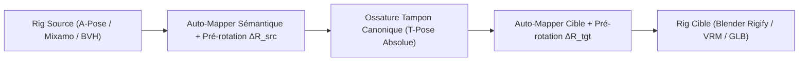

# 🦴 Ossature Tampon Canonique & Moteur d'Auto-Mapping

> **Modules :** `mappings/buffer_armature.py`, `mappings/auto_mapper.py`  
> **Intégration :** `mappings/__init__.py`, `run_marker_retarget.py`  
> **Statut :** Livré & Validé par tests unitaires (`tests/test_auto_mapper.py`)

---

## 1. Pourquoi une Ossature Tampon Canonique ?

Lorsque l'on transfère une animation entre deux personnages 3D arbitraires (ex: une capture MoCap BVH vers un avatar Blender Rigify ou VRoid VRM), la mise en correspondance directe présente deux écueils majeurs :
1. **L'explosion combinatoire :** Établir des passerelles directes $A \to B$ exige $N \times M$ dictionnaires de correspondance manuelle.
2. **Les disparités de poses de repos (A-Pose vs T-Pose) :** Si la source a les bras à 45° vers le bas (A-Pose) et que la cible a les bras horizontaux à 90° (T-Pose), un retargeting naïf applique les rotations relatives sur un repère décalé, provoquant des bras tordus ou encastrés dans le corps.

### Le Principe du Pivot Canonique
L'**Ossature Tampon Canonique (`CanonicalBufferArmature`)** standardise un squelette universel de **55 os** dans une **T-Pose géométrique métrique absolue** :
- Bras rigoureusement horizontaux le long de l'axe $\pm X$.
- Colonne vertébrale et tête dressées le long de $+Y$.
- Regard orienté vers $+Z$.
- Jambes rigoureusement verticales le long de $-Y$.



---

## 2. L'Auto-Identifier Sémantique & Topologique

L'un des défis les plus redoutables du retargeting réside dans l'hétérogénéité des conventions de nommage :

| Os Standard Pivot | Convention Mixamo | Convention Rigify | Convention VRoid / VRM | Convention BVH CMU |
| :--- | :--- | :--- | :--- | :--- |
| **`Hips`** | `mixamorig:Hips` | `DEF-spine` / `root` | `J_Bip_C_Hips` | `Hips` |
| **`LeftArm`** | `mixamorig:LeftArm` | `DEF-upper_arm.L` | `J_Bip_L_UpperArm` | `LeftArm` |
| **`LeftForeArm`** | `mixamorig:LeftForeArm` | `DEF-forearm.L` | `J_Bip_L_LowerArm` | `LeftLowArm` |
| **`LeftShoulder`** | `mixamorig:LeftShoulder` | `DEF-shoulder.L` | `J_Bip_L_Shoulder` | `LeftCollar` |
| **`LeftUpLeg`** | `mixamorig:LeftUpLeg` | `DEF-thigh.L` | `J_Bip_L_UpperLeg` | `LeftUpLeg` |
| **`LeftLeg`** | `mixamorig:LeftLeg` | `DEF-shin.L` | `J_Bip_L_LowerLeg` | `LeftLowLeg` |

La classe `AutoBoneIdentifier` analyse n'importe quel ensemble de noms d'os :
1. **Nettoyage automatique des préfixes :** `mixamorig:`, `DEF-`, `J_Bip_`, `bip01_`, `b_`, etc.
2. **Détection du côté :** Analyse insensible à la casse des préfixes et suffixes (`Left`, `Right`, `_L`, `.R`, etc.).
3. **Appariement lexical par ordre de spécificité :** Analyse des motifs composés (`forearm` avant `arm`, `lowerleg` avant `leg`, `toebase` avant `toe`) pour éliminer toute collision de sous-chaînes.
4. **Filtrage des os auxiliaires :** Élimination automatique des os de physique, vêtements (`cloth`, `skirt`), cheveux (`hair`), os de torsion (`*twist*`) ou armes (`weapon`).

---

## 3. Alignement Vectoriel de Repos ($\Delta R_{\text{align}}$)

Pour convertir automatiquement une A-Pose en T-Pose, le `BufferRigMapper` calcule le quaternion de rotation minimale entre le vecteur directeur de l'os au repos dans le modèle et le vecteur directeur canonique de l'ossature tampon :

$$\vec{u}_{\text{source}} = \frac{\vec{p}_{\text{child}} - \vec{p}_{\text{bone}}}{\|\vec{p}_{\text{child}} - \vec{p}_{\text{bone}}\|}$$
$$\vec{u}_{\text{canon}} = \text{CanonicalBufferArmature.get\_canonical\_direction}(\text{bone})$$
$$\Delta Q_{\text{align}} = \operatorname{QuaternionFromTwoVectors}(\vec{u}_{\text{source}}, \vec{u}_{\text{canon}})$$

Lors de l'application de la frame :
$$Q_{\text{buffer}} = \Delta Q_{\text{align}} \otimes Q_{\text{source}}$$

---

## 4. Mode d'Emploi en Ligne de Commande

Grâce au drapeau `--auto-map`, **aucun fichier JSON de configuration n'est nécessaire** :

```bash
python run_marker_retarget.py \
    --source animation.bvh --source-type bvh \
    --target rig_personnage.glb --target-type mixamo \
    --output resultat_retarget.glb \
    --auto-map \
    --use-temporal-prior
```
Le système détecte les os, effectue l'alignement sur l'ossature tampon, stabilise les rotations par l'état temporel $t-1 \to t$, et produit le fichier final animé.
