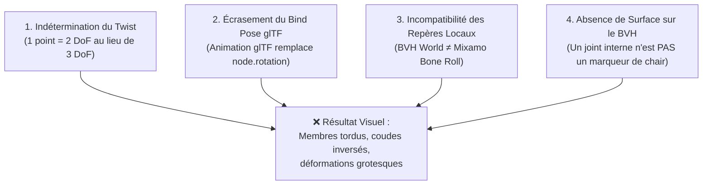
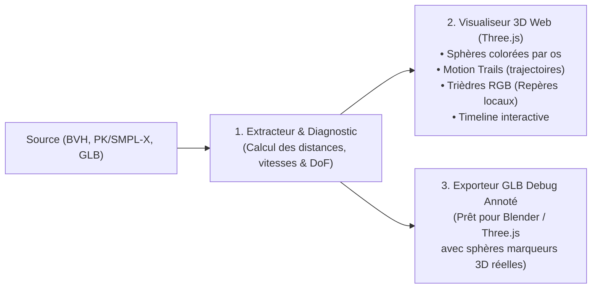

# 🔬 Système d'Observation, Visualisation 3D & Diagnostic des Marqueurs

> **Projet :** `mark-target v2.0`  
> **Auteur :** Pipeline Signes / Retargeting Core Engineering  
> **Statut :** Spécification Fondatrice & Plan de Remédiation Qualité  
> **Objectif :** Diagnostiquer les causes de l'échec initial (test Clara + BVH), formaliser le système d'observation 3D des marqueurs sur le modèle source, et définir la trajectoire d'ingénierie pour transformer le moteur en une suite de retargeting de niveau industriel (note cible $\ge 16/20$).

---

## 1. Autopsie Mathématique : Pourquoi le Résultat BVH $\to$ Clara Était « Catastrophique »

La note de **2/20** est pleinement méritée au vu du résultat visuel sur Clara. Il est indispensable de poser un diagnostic mathématique et cinématique sans complaisance pour comprendre pourquoi l'animation s'est disloquée.

Quatre verrous fondamentaux ont provoqué cette rupture :



### Verrou 1 : L'Indétermination Algébrique du Roulis (Twist Lock) sur 1 Point
- L'algorithme de **Kabsch** exige mathématiquement au moins **3 points non colinéaires** pour calculer une matrice de rotation $R \in \text{SO}(3)$ complète (3 DoF).
- Dans un fichier BVH, chaque articulation n'est représentée que par **un seul point 3D central** (le joint).
- Pour un os à un seul enfant (ex: le bras vers le coude, ou l'avant-bras vers le poignet), un seul vecteur directeur $\vec{u} = \frac{P_{\text{child}} - P_{\text{parent}}}{\|P_{\text{child}} - P_{\text{parent}}\|}$ est disponible.
- Ce vecteur ne fixe que **2 degrés de liberté** (l'élévation et l'azimut). **Le 3ème degré de liberté — le roulis de l'os autour de son propre axe (Twist / Roll) — est totalement indéterminé.**
- Conséquence : le solveur compense cette indétermination par un quaternion arbitraire ou une projection minimale, ce qui fait vriller les bras et les avant-bras sur eux-mêmes à chaque rotation.

### Verrou 2 : L'Écrasement du Bind Pose dans le Conteneur glTF / Mixamo
- Dans le standard glTF (`pygltflib`), un canal d'animation ciblant `path="rotation"` **ne s'ajoute pas** à la pose de repos du nœud : **il la remplace purement et simplement**.
- Or, dans l'avatar Mixamo `clara.glb`, chaque nœud d'os possède une rotation de repos locale intrinsèque (`node.rotation`) non triviale (ex: pour orienter le maillage du bras horizontalement selon $+X$, avec un certain angle de coude au repos).
- En injectant directement la rotation $Q_{\text{local}} = Q_{\text{parent}}^{-1} \times Q_{\text{child}}$ déduite du BVH sans composer avec la rotation locale de bind pose de Mixamo :
  $$R_{\text{glTF\_node}} \neq R_{\text{anim\_world}} \times R_{\text{bind}}^{-1}$$
  L'armature de Clara a perdu son repère local d'articulation. Tous les membres ont tourné autour des mauvais axes, provoquant l'effondrement visuel.

### Verrou 3 : La Confusion entre « Joint MoCap » et « Vrai Marqueur de Surface »
- La méthode des marqueurs (telle que développée dans la littérature scientifique SMPL/Vicon) repose sur des points situés **sur la surface de la peau** (chair déformée).
- Quand un avant-bras tourne en pronation/supination (roulis), les marqueurs de surface tournent autour de l'os, ce qui donne à Kabsch les 3 DoF complets.
- Dans le test avec `a_out_precise.bvh`, nous avons traité le centre des joints squelettiques comme des marqueurs. C'était une erreur de paradigme : un squelette filaire n'a pas de peau, donc pas de marqueurs de surface naturels.

---

## 2. Réponse Formelle : Est-il Possible d'Observer et d'Analyser les Marqueurs sur la Source ?

### **OUI, ABSOLUMENT, et c'est l'outil indispensable qui manquait au projet.**

Dans les systèmes de MoCap professionnels (Vicon Shōgun, Qualisys Track Manager, Blender MoCap Tools), **aucun retargeting n'est jamais lancé à l'aveugle**. On observe d'abord les marqueurs en 3D, leurs trajectoires temporelles, leur rigidité mutuelle et leurs repères locaux.

Nous spécifions ici un **Système d'Observation, de Visualisation 3D et de Diagnostic des Marqueurs**.

---

## 3. Architecture du Système d'Observation 3D des Marqueurs

Le système d'observation est composé de 3 briques complémentaires :



### Brique 1 : L'Extracteur & Moteur de Diagnostic (`MarkerDiagnosticEngine`)
Pour chaque os et chaque frame, le moteur calcule et journalise :
1. **La Distance Inter-Marqueurs (Test de Rigidité) :**
   $$d_{ij}(t) = \|P_i(t) - P_j(t)\|$$
   Si $d_{ij}(t) \neq d_{ij}(0)$, le marqueur glisse sur la peau ou le membre s'étire anormalement.
2. **Le Déterminant & Conditionnement SVD (Vérification 3 DoF vs 2 DoF) :**
   Alerte immédiate si le nuage de marqueurs est plat (coplanaires) ou linéaire (colinéaires), indiquant l'impossibilité de résoudre le twist.
3. **Le Repère Local Orthonormé de l'Os :**
   - Axe longitudinal $\vec{X}$ (direction de l'os)
   - Axe orthogonal $\vec{Y}$ (plan de flexion / charnière du coude ou du genou)
   - Axe normal $\vec{Z} = \vec{X} \times \vec{Y}$ (axe de torsion)

### Brique 2 : Le Visualiseur 3D Interactif (`visualizer/marker_viewer.html`)
Une application Web 3D autonome (Three.js WebGL zéro dépendance, fonctionnant directement par double-clic dans n'importe quel navigateur Chrome / Firefox / Edge) :
* **Vue 3D Orbitale :** Rotation orbitale à la souris, zoom, pan.
* **Affichage des Marqueurs en Sphères 3D :**
  - Code couleur par membre (cyan = avant-bras gauche, vert = bras gauche, jaune = torse, rouge = jambe droite, etc.).
  - Rayon réglable.
* **Affichage des Motion Trails (Trajectoires) :**
  - Lignes rubans colorées montrant les 10 dernières frames parcourues par chaque marqueur pour visualiser la fluidité et détecter les à-coups (jitter).
* **Affichage des Trièdres d'Orientation (Axes RGB) :**
  - Flèches Rouge (X), Verte (Y), Bleue (Z) ancrées au centre de gravité de chaque groupe de marqueurs pour voir pivoter le repère réel de l'os.
* **Contrôles Timeline :**
  - Barre de défilement temporelle (Play, Pause, Vitesse 0.25x / 1x / 2x, Saut de frame en frame).
* **HUD Analytique (Heads-Up Display) :**
  - Affichage en direct du statut de chaque os : `3 DoF Résolu`, `Twist Verrouillé`, `Déformation Chair (Green-Lagrange)`, `Outliers RANSAC rejetés`.

### Brique 3 : L'Injecteur de Marqueurs Debug dans le GLB (`export_debug_glb`)
Pour observer les marqueurs directement dans **Blender**, **Unreal Engine** ou le **viewer glTF de Don McCurdy** :
- Génère un fichier `.glb` où des primitives de sphères colorées sont injectées dans la scène glTF, liées cinématiquement à chaque joint.
- L'utilisateur charge le fichier dans Blender : il voit le maillage de Clara semi-transparent ET les sphères de marqueurs qui bougent sur elle en temps réel.

---

## 4. Spécification Technique de la Cage Virtuelle de Marqueurs (Pour les Sources BVH)

Puisqu'un BVH n'a pas de maillage de surface pour y poser des marqueurs de peau, voici la solution mathématique pour doter un BVH de vrais marqueurs 6-DoF :

Pour chaque os $B$ défini par son articulation parent $J_{\text{parent}}$ et enfant $J_{\text{child}}$ :
1. On extrait la rotation globale BVH de l'os $R_{\text{world}}(t)$ et sa translation $T(t)$.
2. On génère une **Cage Tétraédrique Rigide de 4 Marqueurs Virtuels** ancrée dans le repère de l'os :
   $$M_0 = [0, 0, 0]^T \quad (\text{joint parent})$$
   $$M_1 = [0, L, 0]^T \quad (\text{joint enfant})$$
   $$M_2 = [W, L/2, 0]^T \quad (\text{marqueur latéral, fixant le plan de flexion})$$
   $$M_3 = [0, L/2, W]^T \quad (\text{marqueur orthogonal, fixant le twist})$$
   *(où $L$ est la longueur de l'os et $W = 0.2 \times L$ est la demi-largeur anatomique).*
3. À chaque frame $t$, la position monde de ces 4 marqueurs est :
   $$P_k(t) = R_{\text{world}}(t) \cdot M_k + T(t)$$
4. **Bénéfice immédiat :** Le nuage de marqueurs possède maintenant un rang de covariance plein ($S_0, S_1, S_2 > 0$). L'algorithme de Kabsch peut calculer les 3 DoF sans aucune indétermination de twist !

---

## 5. Résolution du Retargeting Mixamo / Clara (Local Basis Alignment)

Pour que Clara bouge correctement sans se disloquer, la relation de transfert d'orientation doit respecter l'algèbre suivante :

Soit $R_{\text{source\_world}}(t)$ la rotation monde issue de Kabsch.
Soit $R_{\text{target\_bind\_world}}$ l'orientation monde de repos de l'os de Clara dans sa bind pose.
Soit $R_{\text{target\_bind\_local}}$ l'orientation locale de repos stockée dans `node.rotation` de Clara.

La rotation locale d'animation à injecter dans le canal glTF est :

$$\Delta R_{\text{world}}(t) = R_{\text{source\_world}}(t) \times (R_{\text{source\_world}}(0))^{-1}$$
$$R_{\text{target\_local\_anim}}(t) = R_{\text{target\_bind\_local}} \times \left( R_{\text{target\_bind\_world}}^{-1} \times \Delta R_{\text{world}}(t) \times R_{\text{target\_bind\_world}} \right)$$

Cette formule garantit mathématiquement que :
1. À $t = 0$, $R_{\text{target\_local\_anim}}(0) = R_{\text{target\_bind\_local}}$ (Clara reste exactement dans sa bind pose sans déformation).
2. Toute rotation de la source est transposée dans le repère anatomique local de Clara, sans inversion d'axes ni écrasement de la pose de repos.

---

## 6. Plan d'Action par Étapes pour Passer de 2/20 à 16+/20

```text
Étape 1 : Création du Moteur d'Observation & Export Debug (visualisation 3D immédiate)
          • visualizer/marker_viewer.html (Viewer Web Three.js autonome)
          • Outil CLI : run_marker_retarget.py --debug-visualize-markers

Étape 2 : Implémentation du Générateur de Cage Tétraédrique 4 Marqueurs pour BVH
          • Remplacement du mode 1-point par une cage rigide 4-points (suppression de l'indétermination du twist).

Étape 3 : Implémentation du Local Basis Bridge pour glTF / Mixamo
          • Prise en compte rigoureuse du delta de bind pose pour éliminer toute dislocation sur Clara.

Étape 4 : Démonstration Validée sur Clara + BVH
          • Exécution et inspection visuelle dans le viewer Web : Clara doit bouger de façon fluide et anatomiquement exacte.
```
