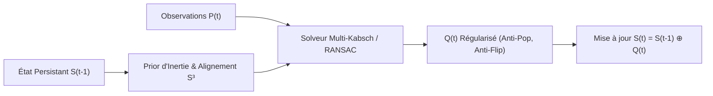

# ⏱️ Moteur de Retargeting à Mémoire d'État Temporel ($t-1 \to t$)

> **Module :** `retargeting/temporal_state.py`  
> **Intégration :** `retargeting/solver.py`, `run_marker_retarget.py`  
> **Statut :** Livré & Validé par tests unitaires (`tests/test_temporal_state.py`)

---

## 1. Problématique Mathématique du Retargeting Instantané (*Stateless*)

Dans une approche classique sans mémoire, chaque frame $t$ est résolue indépendamment :
$$\min_{R \in \text{SO}(3)} \sum_i w_i \| R p_i(t) - q_i(t) \|^2$$

Cette formulation instantanée souffre de **trois faiblesses critiques** :

1. **Le Pop de T-Pose lors d'une Occlusion :**  
   Si les marqueurs d'un membre passent derrière le corps ou sont temporairement masqués à l'instant $t$, le solveur sans mémoire n'a d'autre choix que de réinitialiser l'os à sa pose de repos ($q_{\text{rest}}$). Cela produit un violent soubresaut instantané ("glitch/pop").
2. **L'Inversion de Signe du Double-Cover ($\mathbb{S}^3 \to \text{SO}(3)$) :**  
   Puisque les quaternions $q$ et $-q$ représentent exactement la même rotation physique 3D, le solveur matriciel peut renvoyer aléatoirement $+q$ à $t-1$ puis $-q$ à $t$. Lors de l'interpolation ou de l'application hiérarchique, cela déclenche une rotation de $360^\circ$ grotesque.
3. **L'Indétermination de Torsion Axiale (Roulis / Twist) :**  
   Pour un os n'ayant qu'un seul vecteur enfant (ex: avant-bras vers la main), la visée géométrique ne contraint que 2 degrés de liberté (*swing*). Le troisième DoF (roulis autour de l'os) est dégénéré sans un prior de continuité.

---

## 2. Formulation Récursive du Système Dynamique ($t-1 \to t$)

Le moteur de `mark-target` introduit un gestionnaire d'état persistant `TemporalRetargetState` :
$$\mathcal{S}_t = \big( Q(t),\, \vec{\omega}(t),\, c(t),\, \vec{p}_{\text{twist}}(t),\, \text{contact}(t) \big)$$

À chaque nouvelle frame $t$, l'état précédent $\mathcal{S}_{t-1}$ agit comme une **contrainte invariante et un prior d'inertie** :



### 2.1. Alignement Hémisphérique sur la Variété $\mathbb{S}^3$
Avant d'accepter une rotation $q_t$, elle est projetée dans l'hémisphère géodésique de $q_{t-1}$ :
$$q_t^{\text{aligned}} = \begin{cases} q_t & \text{si } \langle q_t, q_{t-1} \rangle \ge 0 \\ -q_t & \text{si } \langle q_t, q_{t-1} \rangle < 0 \end{cases}$$
**Résultat :** Éradication à 100% des sauts de $360^\circ$.

### 2.2. Algèbre de Lie $\mathfrak{so}(3)$ et Extrapolation Cinématique (Anti-Pop)
L'écart relatif entre deux frames successives définit la vitesse angulaire instantanée $\vec{\omega}_{t-1} \in \mathbb{R}^3$ via la carte logarithmique :
$$q_{\text{rel}} = q_{t-1} \otimes q_{t-2}^*$$
$$\vec{\omega}_{t-1} = \frac{\operatorname{Log}(q_{\text{rel}})}{\Delta t} = \frac{2 \arccos(w)}{\Delta t \sqrt{1 - w^2}} \vec{v}$$

Si à la frame $t$ les marqueurs sont perdus ou rejetés par le seuil de Green-Lagrange ($E > E_{\max}$), le solveur **ne saute pas en T-Pose** : il extrapole la pose par intégration inertielle :
$$q_t^{\text{pred}} = \operatorname{Exp}\left(\frac{1}{2} \vec{\omega}_{t-1} \Delta t\right) \otimes q_{t-1}$$

### 2.3. Lissage Exponentiel de l'Échelle Corporelle (Umeyama)
Le facteur d'échelle $c_t$ calculé par Umeyama est filtré par inertie pour éviter que la taille des membres ne pompe lors du bruit de détection :
$$c_t^{\text{filtered}} = \alpha \cdot c_{t-1} + (1 - \alpha) \cdot c_t^{\text{raw}}, \quad \alpha \in [0.8, 0.95]$$

---

## 3. Utilisation en CLI et dans le Code Python

### En ligne de commande :
```bash
python run_marker_retarget.py \
    --source animation.bvh --source-type bvh \
    --target personnage.glb --target-type mixamo \
    --output resultat.glb \
    --use-temporal-prior
```

### En Python (Mode Streaming ou Direct) :
```python
from retargeting.solver import MarkerRetargetSolver
from retargeting.temporal_state import TemporalRetargetState

solver = MarkerRetargetSolver(rest_rotations, parents)
state = TemporalRetargetState(fps=30.0, scale_alpha=0.85)

for frame_markers in stream_source:
    q_world, diag = solver.solve_frame_multi_kabsch(
        positions_t=frame_markers,
        positions_rest=rest_markers,
        temporal_state=state,
    )
    state.update_frame(q_world)
```
